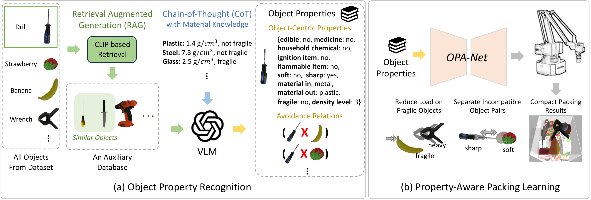

<h1 align="center">OPA-Pack: Object-Property-Aware Robotic Bin Packing</h1>

  Jia-Hui Pan, Yeok Tatt Cheah, Zhengzhe Liu, Ka-Hei Hui, 
  Xiaojie Gao, Pheng-Ann Heng, Yun-Hui Liu, and Chi-Wing Fu

  
  &ensp;
  
  &ensp;
  

---

OPA-Pack combines object-property recognition with reinforcement learning to pack everyday objects compactly while separating incompatible items and reducing loads on fragile objects.

  

## 🧩 Method

**1. Recognize object properties.** A vision-language model takes four rendered views, the category, and the size of each object to predict eleven physical and semantic properties. CLIP-based retrieval supplies similar annotated examples, while material-aware reasoning estimates inner and outer materials to infer fragility and density. Rules then identify incompatible pairs, including sharp and soft objects, chemicals and food, medicines and food, and ignition and flammable items.

**2. Represent objects and the container.** OPA-Net combines PointNet geometry features with learned object-property embeddings. Three heightmaps describe the container: occupancy records the packed surface, fragility tracks fragile objects, and a candidate-specific avoidance map locates packed objects incompatible with the object being considered.

**3. Learn what to pack and where.** An object Q-predictor selects the next object from the buffer. A placement Q-predictor then scores candidate orientations and positions to choose its placement. OPA-Net is trained with dueling deep Q-learning and a reward that jointly encourages compact packing, reduces load on fragile objects, and separates incompatible pairs.

## 📦 Dataset

[Download the OPA dataset from Google Drive](https://drive.google.com/file/d/1qTvWi1o9Gw3bzNREq3stjnYPLb7ZfrM6/view?usp=sharing)

The OPA dataset contains **1,032 everyday objects** from Objaverse-v1, grouped by use:

| Subset | Objects |
| --- | ---: |
| Kitchen | 497 |
| Hardware and Stationery | 302 |
| Daily Necessities | 233 |
| **Total** | **1,032** |

Each object retains its 3D geometry and class name and has **11 predicted properties**:

- **5 semantic labels:** medicine, edible item, household chemical, ignition item, and flammable item.
- **6 physical properties:** softness, sharpness, inner material, outer material, fragility, and density level.

These labels also define which object pairs should be packed apart, such as sharp tools and soft fruit.
